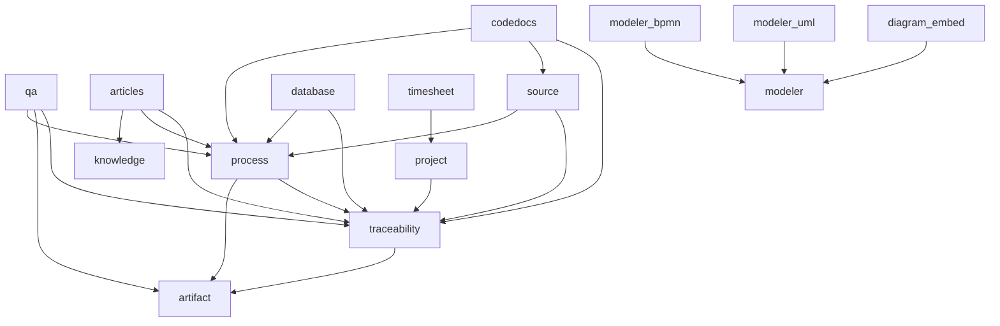

# Arquitectura actual

Los paths de código de este informe se interpretan desde la raíz de Studio. El [inventario generado](evidence/inventory.json) enumera dependencias declaradas, entidades, servicios y clases de prueba por módulo.

## Módulos, entidades y relaciones

`R` indica entidad con tabla de revisiones; no implica revisiones inmutables ni revisión nueva en cada escritura. Las demás entidades de contenido no tienen esa garantía.

| Módulo `divengine_*` | Responsabilidad y almacenamiento |
| --- | --- |
| `core` | Secuencias de códigos, componentes y helpers de presentación; sin entidades propias. |
| `artifact` | `artifact` (R), bundles `artifact_type`; conocimiento de ingeniería, campos por bundle y moderación. |
| `traceability` | `trace_link` (R), `trace_link_type`; extremos polimórficos por tipo/id, reglas semánticas, paneles y referencias `[[CODE]]`. |
| `modeler` | `diagram` (R), `diagram_type`; notaciones, edición con control de revisión, enlaces de elementos e índices derivados, previews SVG. |
| `modeler_bpmn` | Plugin BPMN con bpmn-js; usa diagramas del modelador. |
| `modeler_uml` | Plugin UML/PlantUML con editor CodeMirror; usa diagramas del modelador. |
| `diagram_embed` | Filter y CKEditor 5, iframe/preview y tabla derivada de usos de diagramas; sin nueva entidad de negocio. |
| `process` | `development` (R), `change_request` (R), `development_phase`, `iteration`, `milestone`, `process_activity`, `role_assignment`, `baseline`. Configuración: `development_case`, `process_phase_type`, `process_discipline`, `process_role`, `activity_definition`, `work_product_definition`. Añade `artifact.development` y bundles UP; no introduce otra entidad work product. |
| `qa` | `qa_test_plan`, `qa_test_suite`, `qa_test_case`, `qa_test_step`, `qa_test_run`, `qa_test_execution`, `qa_step_result`, `qa_issue`, `qa_log`, `qa_result_correction`. Configuración: `qa_environment`, `qa_priority`, `qa_stage`, `qa_tag`. Snapshots de ejecución y correcciones como registros propios. |
| `project` | `project`, `project_task` (R), configuración `project_stage` y `project_task_type`. Ámbito independiente de Development; integración por trazas. |
| `timesheet` | `timesheet`, temporizador, registro y reportes por proyecto/tarea. |
| `knowledge` | Taxonomías de conocimiento sobre entidades core. |
| `articles` | Bundle core `node:knowledge_article`, árbol, código y `kb_development`; node access grants. |
| `thread` | Comentarios y adjuntos de entidades core, campos/configuración por host; no entidad de conversación paralela. |
| `source` | `source_repository`, `source_ref`, `source_snapshot`; consulta Git local, commits fijados e índice. Pertenece a Development. |
| `database` | `schema_database`, `schema_snapshot`, tablas normalizadas de facts; adapters, importación, diff y findings. Pertenece a Development. |
| `codedocs` | `codedoc_set`, `codedoc_snapshot`, seis tablas de facts y almacenamiento de lotes; adapters, cargas fragmentadas, cobertura, búsqueda, referencias y diff. Pertenece a Development y puede vincularse a Source. |
| `mcp` | Setup de cuenta/token y recipe de acceso MCP de lectura; plugins adicionales pertenecen a Source, Database y CodeDocs. |

### Dependencias declaradas

Flecha = «depende de». Se omiten las flechas comunes a `core` y las dependencias Drupal/contrib para facilitar la lectura; el inventario las conserva por separado. El grafo de dependencias personalizadas declarado es acíclico.

El grafo no representa todo acoplamiento en ejecución: `process` agrega campos/constraints a `artifact` y `trace_link` por hooks; Thread enumera hosts opcionales y Core contiene un helper de findings ligado a Database. No hay que convertir esas referencias en dependencias inversas que creen ciclos.

## Servicios y extensiones

Los archivos `*.services.yml` contienen servicios concretos y collectors; el inventario conserva sus identificadores. No se encontró una delimitación explícita y documentada de API pública frente a servicios internos. La visibilidad del contenedor no equivale a exposición HTTP. No se recomienda crear una interfaz para cada clase.

| Contrato actual | Extensión apropiada y límite |
| --- | --- |
| `artifact_type` + field config + Workflows | Nuevos tipos de conocimiento mediante configuración; no requieren una entidad por disciplina. |
| `trace_link_type` | Relaciones, extremos admitidos e inversas mediante config. Reglas especiales UP todavía viven en `ProcessTraceConstraintValidator`. |
| `ModelerNotationManager` / `ModelerNotationInterface` | Plugins de notación. BPMN y UML implementados; no confundir otras notaciones previstas con plugins disponibles. |
| `ReadinessCriterionManager` / `ReadinessCriterionInterface` | 11 criterios de Process y tres de QA; evaluación explicativa, nunca bloqueo de transición. |
| Collectors de adapters Database/CodeDocs | Servicios etiquetados e interfaces de contrato; formatos externos normalizados antes de persistir. |
| `divengine_trace_end_types_alter` | Extremos de trazas adicionales. No resuelve por sí solo sus políticas de query access. |
| `divengine_process_scoped_types_alter` | Tipos con campo `development`; no cubre automáticamente `kb_development` ni Project. |
| `divengine_code_fields_alter`, `divengine_thread_types_alter` | Códigos y hosts de conversación adicionales. |

Los servicios de escritura que merecen contrato explícito primero son `BaselineRecorder`, `LifecycleManager`, `SnapshotImporter` de Database/CodeDocs y `QaResultRecorder`. Hay que definir validación, autorización del llamador, transacciones y errores. Los lectores `CodeResolver`, `ReferenceIndex`, paneles y plugins MCP deben conservar la política y cacheabilidad de las entidades consultadas.

Las tarjetas de overview de Development se construyen concretamente en `DevelopmentViewBuilder`, aunque ADR-0007 las describe como plugins. No se encontró un manager de tarjetas. Primero debe resolverse si la extensibilidad ya es necesaria: un hook de render existente o composición de render arrays puede bastar; un sistema nuevo de eventos sería prematuro.

## Configuración, recipes y estados

`recipes/divengine_studio/recipe.yml` parte de la recipe standard, instala 17 módulos propios más temas/dependencias, importa bundles, Views, workflows y vocabularios, configura formatos/editores y roles. `strict: false` mantiene configuración personalizada al reaplicar; no constituye una migración de configuración existente ni prueba que todos los update hooks se ejecuten correctamente.

`recipes/divengine_studio_mcp/recipe.yml` instala la integración opcional, JSON:API/schema, Key y MCP. Mantiene autenticación habilitada y activa plugins de lectura. El setup posterior crea cuenta/rol y token en archivo externo al webroot con permisos restrictivos. No todos los módulos se instalan por la misma recipe.

Hay dos mecanismos de ciclo de vida intencionadamente distintos:

* Los artefactos y diagramas usan Drupal Content Moderation. `requirement_lifecycle` tiene `draft → proposed → approved → published` (etiqueta **Baselined**) y `deprecated`; `approved` no es todavía una revisión publicada/default. Casos de uso y work products tienen workflows propios. `artifact_lifecycle` usa draft/review/published/archived para conocimiento general. No normalizar estos vocabularios con una sustitución global.
* Development, iteraciones, milestones, actividades y change requests usan `StatefulInterface`, `Transition` y `LifecycleManager`. El manager aplica origen, guard, effect, validación, revisión cuando procede y callback posterior. Los botones/controladores aplican permisos; el servicio no representa por sí mismo una frontera de autorización.

La suite demuestra que una revisión explícitamente enviada a draft deja vigente la revisión publicada. No demuestra que toda escritura de contenido aprobado se convierta automáticamente en draft. Las sondas muestran el límite de ese contrato en escrituras directas.

| Registro | Máquina implementada / guard relevante |
| --- | --- |
| Development | planned → active ↔ on_hold → closed; cancel desde planned/active/on_hold. |
| Iteration | planned → active → done; cancel desde planned/active. Empezar actualiza `current_iteration` del Development como efecto posterior. |
| Milestone | planned → reached; reset a planned. Registra fecha y captura baseline después del save; readiness advisory. |
| Activity | planned/blocked → ready; planned/ready/blocked → in_progress; block exige motivo; complete desde ready/in_progress exige outputs o desviación; skip exige desviación; replan desde skipped/completed/blocked. |
| Change Request | submitted → triaged → accepted/rejected; aceptar/rechazar exige rationale y registra decisor/fecha. accepted → scheduled exige iteración; scheduled → implemented → verified → closed; rejected también puede cerrar; accepted/rejected permite retriage. |
| Work Product | Moderación: draft → in_review → published (etiqueta Baselined), retorno a draft. No tiene los mismos estados que Activity ni una entidad de «superseded» separada. |

Fuentes: métodos `transitions()` de las entidades de Process y `config/install/workflows.workflow.*.yml`. Los guards de negocio están implementados en esos métodos/servicios; la brecha demostrada está en exigirlos a todos los escritores soportados, no en su inexistencia.

QA ya tiene contratos locales que conviene aprovechar como referencia: `QaTrustedWriteTrait::saveTrusted()` delimita escrituras de servicios, `QaDeletion` participa en preDelete y `QaResultCorrection::preSave()/preDelete()` rechaza alterar o borrar el audit trail. No se probaron esos contratos aquí. Un flag de escritura confiable tampoco debe confundirse con autenticación; su seguridad depende del servicio que autoriza la operación.

## Contextos e integraciones

Development está definido por Process pero ya funciona como contexto de QA, Source, Database, CodeDocs y artículos. Su visibilidad depende de miembros, creador, responsable o administración; los roles metodológicos no conceden acceso. Los servicios de query access filtran entidades de ese contexto.

Project tiene sus propios miembros, manager y jerarquía de tareas. ADR-0009 acepta esa separación. Diagram es global según sus permisos y propiedad; ADR-0004 deja compartir por ámbitos más finos fuera del alcance inicial. Knowledge combina taxonomías globales con artículos que pueden tener Development. Por tanto, hoy **no todo registro de Studio pertenece a Development**.

QA usa trazas de verificación hacia requisitos y aporta readiness. Source fija commits y limita raíces locales. Database y CodeDocs reciben datos por formularios/API de importación y los exponen a MCP mediante acceso al conjunto/contexto. Sus facts son almacenamiento técnico dependiente del snapshot, no una entidad Drupal por símbolo, columna o parámetro: es una decisión razonable para ese volumen.

MCP se configura para lectura, al igual que JSON:API por defecto. Eso reduce superficie de escritura pero no corrige un handler de lectura insuficiente. Un cliente de solo lectura puede recibir metadatos que el handler de una traza considere visibles de forma incorrecta.

| Frontera de acceso | Implementación observada |
| --- | --- |
| Artifact / Diagram | Permisos generales y por bundle, edición/propiedad/revisiones según handler; el hook de Process agrega restricción de Development a Artifact. |
| Development y registros operacionales | `use unified process`, administración y membresía/creador/responsable. `ScopedAccessControlHandler` sigue view/update del Development; delete depende de administración o tipo ligero. La constraint limita asignar a un contexto no editable. |
| Transiciones HTTP | `ProcessController::transitionAccess()` exige update y transición disponible; ruta directa con CSRF, confirmación por Form API. No equivale a que `LifecycleManager::apply()` autorice una llamada PHP independiente. |
| Project / Task | `ProjectVisibility`, miembros y jerarquía propia; no hereda permiso por ver un Development relacionado. |
| QA | Roles y servicios distinguen diseño, ejecución propia y administración; resultados/evidencia y correcciones tienen restricciones específicas. No basta el permiso amplio de contexto para inferir acceso a toda referencia. |
| Articles / Thread | Node grants y acceso del host; archivos privados requieren conservar esa política en descarga y referencias. |
| Source / Database / CodeDocs | Permisos de uso/publicación y acceso a Development/conjunto; facts consultados a través del snapshot y su contenedor. Las APIs de importación no se sustituyen por MCP. |
| MCP | Cuenta autenticada, rol de lectura y pertenencia al contexto; plugins no conceden membresía automáticamente. |

La caché de resultados permitidos y denegados debe conservar dependencias de cuenta/permisos y entidades relevantes. La existencia de `accessCheck(TRUE)` no asegura por sí sola que todas las políticas concretas estén implementadas en query access; F01 lo reproduce.

## Alcance real de baselines

`BaselineRecorder::take()` selecciona artefactos **default** del Development cuyo estado efectivo es `published` o cuyo `status` está activo si no tienen lifecycle. Agrega trazas cuyos dos extremos son artefactos seleccionados y guarda triples `entity_type/entity_id/revision_id` en `divengine_process_baseline_item`. No filtra adicionalmente el status de esas trazas.

| Concepto | Implementación actual |
| --- | --- |
| Baseline de artefactos | Sí: selección de artefactos efectivos y trazas internas, con los defectos históricos identificados. |
| Baseline de requisitos | Los requisitos pueden formar parte del conjunto; no existe un selector persistido específico «solo requisitos». |
| Baseline integral de configuración | No: no congela bundles, workflows, caso completo versionado, miembros, QA, diagramas, Git, schemas ni CodeDocs como un paquete único. |

Las trazas actuales apuntan a identidad lógica. La baseline fija la revisión de la traza y de los artefactos; no fija por sí sola la versión de `trace_link_type`, de las etiquetas ni de toda configuración de interpretación. La reconstrucción exacta debe definir si significa contenido histórico o también representación/configuración. Ampliar a baseline integral es una decisión futura, no requisito para corregir el historial existente.

## Contraste arquitectónico

ADR-0001 y ADR-0006 se reflejan bien en entidades nativas y recipes. ADR-0002 sigue marcado **Proposed** aunque ADR-0007 lo trata como antecedente decidido; su estado debe reconciliarse sin aprobarlo retroactivamente. Work products como bundles cumplen ADR-0007. Los test cases de conocimiento (`artifact:test_case`) y los ejecutables (`qa_test_case`, ADR-0008) necesitan una explicación semántica, no una fusión automática.

ADR-0007 promete códigos estables, transiciones exclusivas e historial no eliminable. Las constraints y access hooks implementan parte del diseño; las sondas muestran que el contrato no está completo a nivel de persistencia. El uso de OWL en Database está expresamente aceptado por ADR-0013: su procedencia no es motivo para reescribirlo.
